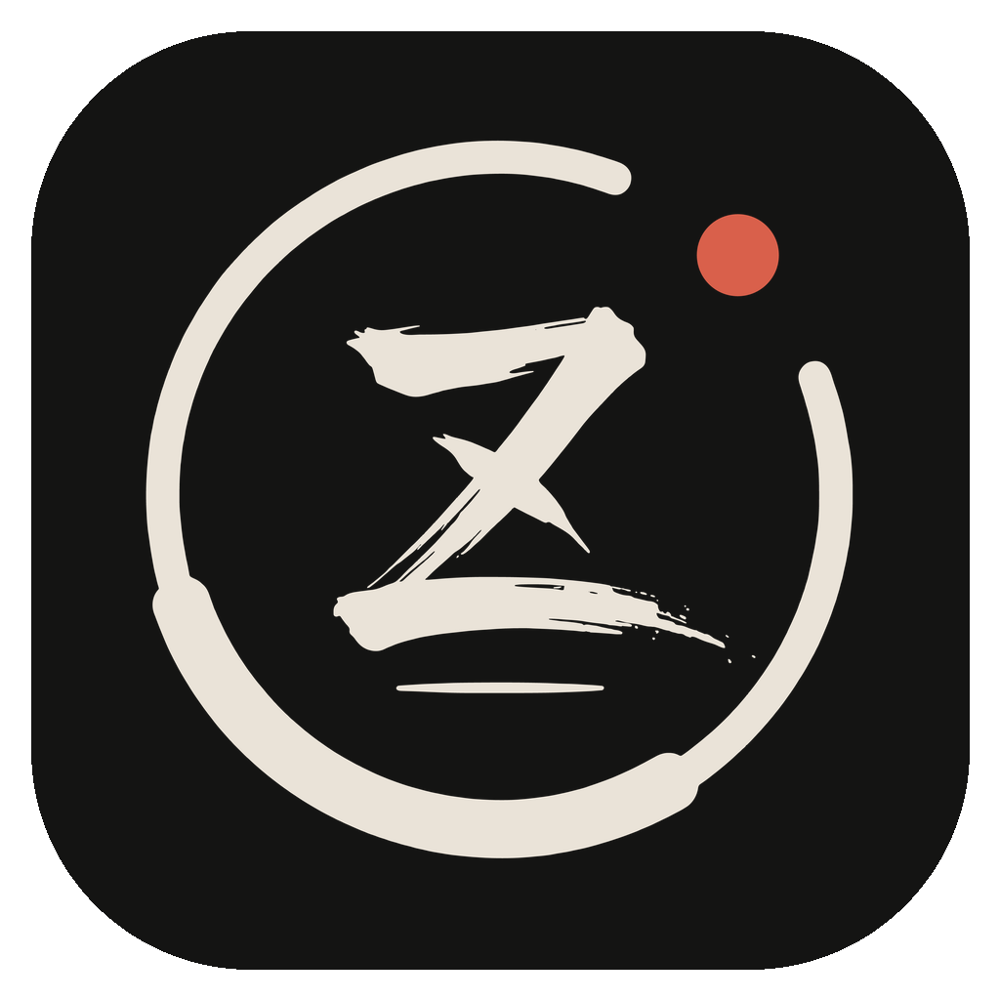

<p align="center"></p>

# ZenPDF for Mac

A calm, distraction-free PDF reader and annotator for macOS, written in Swift and SwiftUI. Open a folder, then read, mark up and cite your documents. The annotations are saved into the PDF itself, so Preview and other PDF viewers show them too.

There's also [ZenPDF for Windows](https://github.com/duck28/zenpdf-for-windows). Both apps save annotations the same way, so a file marked up on one can be edited on the other.

## Features

- **Calm reading:** zoom from 25 to 500 percent (⌘+ and ⌘−, ⌘ and scroll, or pinch), fit the page or its width, and jump between page thumbnails. Hide the sidebar (⌘B) and only the page is left.
- **Highlighter:** highlights blend into the page like ink, so the text underneath stays sharp. Hold still at the end of a stroke and it straightens out.
- **Pens:** ballpoint, fountain, marker, pencil or dashed, in any color and thickness.
- **Text, shapes and a ruler:** notes anywhere on the page, rectangles, ellipses, lines and arrows (Shift keeps squares, circles and 45° angles), and measurements in centimeters, millimeters or inches.
- **Citations with footnotes:** mark a passage and ZenPDF numbers it, captures its text and adds your note as a footnote. Copy the reference in APA, MLA, Chicago or BibTeX.
- **Annotations stay editable:** marks are saved as real PDF annotations. Open the file in ZenPDF again and you can move, resize, change or erase every one. Undo and redo included.
- **Share a clean copy:** export a flattened PDF with the annotations merged into the pages, or save the current page as a PNG.
- **Your folder, at hand:** browse a folder's documents in the sidebar, with subfolders, file sizes and a filter. ZenPDF reopens the file and folder you last worked on.
- **Text and Markdown:** open `.txt` and `.md` files next to your PDFs and edit them in place, with an edit, split and preview view for Markdown.

ZenPDF works offline, has no account and doesn't upload your files anywhere.

## Download and install

Requires macOS 14 or later on a Mac with Apple silicon.

1. Download `ZenPDF-<version>-mac-arm64.dmg` from the [latest release](https://github.com/duck28/zenpdf-for-mac/releases/latest).
2. Open the disk image and drag **ZenPDF** to **Applications**.
3. Open ZenPDF. The first time, macOS blocks it (see below).

### The app is not signed or notarized

Release builds are ad-hoc signed, not signed with an Apple Developer ID or notarized by Apple. When you open ZenPDF for the first time, Gatekeeper says that Apple could not verify it is free of malware and offers only **Done** or **Move to Trash**. To open it anyway:

1. Click **Done**.
2. Open **System Settings › Privacy & Security**, scroll down to the message about ZenPDF, and click **Open Anyway**. Confirm with your password.

Alternatively, remove the quarantine flag in Terminal: `xattr -dr com.apple.quarantine /Applications/ZenPDF.app`.

On macOS 14 you can also right-click the app and choose **Open**.

### Verify a download

Every release file is attested by the GitHub Actions run that built it ([build provenance](https://docs.github.com/actions/security-for-github-actions/using-artifact-attestations)). With the [GitHub CLI](https://cli.github.com):

```bash
gh attestation verify ZenPDF-1.0.0-mac-arm64.dmg --repo duck28/zenpdf-for-mac
```

## Keyboard shortcuts

| Shortcut | Action |
| --- | --- |
| ⌘O / ⇧⌘O | Open a file / a folder |
| ⌘S / ⇧⌘S | Save / Save as |
| ⌘Z / ⇧⌘Z | Undo / Redo |
| ⌘+ / ⌘− / ⌘0 | Zoom in / out / 100% |
| ⌘B | Show or hide the sidebar |
| V or 1 | Select (double-click a text note to edit it) |
| H or 2 | Highlighter |
| P or 3 | Pen |
| T or 4 | Text (Return finishes, Shift-Return adds a line) |
| R or 5, O, L, A | Rectangle, ellipse, line, arrow |
| M | Ruler |
| C | Cite |
| E or 6 | Eraser |
| Delete | Delete the selected annotation |
| Esc | Cancel the current stroke, or clear the selection |

## Build from source

Needs macOS 14 or later and the Xcode Command Line Tools (`xcode-select --install`); Xcode itself isn't required.

```bash
./build.sh
```

This builds the app for Apple silicon at `build/ZenPDF.app` and a disk image at `build/ZenPDF.dmg`. The app is ad-hoc signed. To sign it with your own identity, pass `SIGN_IDENTITY="Developer ID Application: …" ./build.sh` (it would also need notarizing to open without a warning on other Macs).

- `./build.sh debug` builds a debug app without the disk image.
- `swift test` runs the unit tests. They save and reopen annotations through PDFKit, and open `Tests/ZenPDFTests/Fixtures/windows-saved.pdf`, a file saved by ZenPDF for Windows.
- The [build workflow](.github/workflows/build.yml) builds and tests every push to `main` and every pull request. It also uploads `mac-saved-fixture`, a PDF saved by this app, for checking the other direction with the Windows code.

## Releasing

1. Set the new version (for example `1.0.1`) as `CFBundleShortVersionString` in `Resources/Info.plist`.
2. Commit, then push a tag that matches the version with a `v` in front:
   ```bash
   git tag v1.0.1 && git push origin v1.0.1
   ```
3. The [release workflow](.github/workflows/release.yml) checks that the tag matches the version, runs the tests, builds the disk image on a macOS runner, attests it, and creates a **draft** release with `ZenPDF-<version>-mac-arm64.dmg`. Review it on GitHub and publish it.

## Code

| Part | File |
| --- | --- |
| App, menus and window | `Sources/ZenPDF/ZenPDFApp.swift`, `ContentView.swift` |
| Open, save, export, undo, folder and session | `Sources/ZenPDF/DocumentModel.swift` |
| Page viewer and drawing gestures | `Sources/ZenPDF/PageCanvas.swift` |
| Tool dock, sidebar, citation panel, text editor | `ToolDock.swift`, `SidebarView.swift`, `CitationPanel.swift`, `TextDocumentView.swift` |
| Annotation model (the same JSON as Windows) | `Sources/ZenPDF/Annotation.swift` |
| Shapes, hit testing, resizing, footnotes | `Sources/ZenPDF/AnnotationGeometry.swift` |
| Annotations stored in the PDF | `Sources/ZenPDF/PDFFormat.swift` |
| Drawing annotations and the PNG export | `Sources/ZenPDF/PartsRenderer.swift` |
| Citation formatting (APA, MLA, Chicago, BibTeX) | `Sources/ZenPDF/Citations.swift` |
| Colors (paper and ink, one vermilion accent) and logo | `Sources/ZenPDF/Theme.swift`, `Resources/Branding/` |

## License

[MIT](LICENSE)
